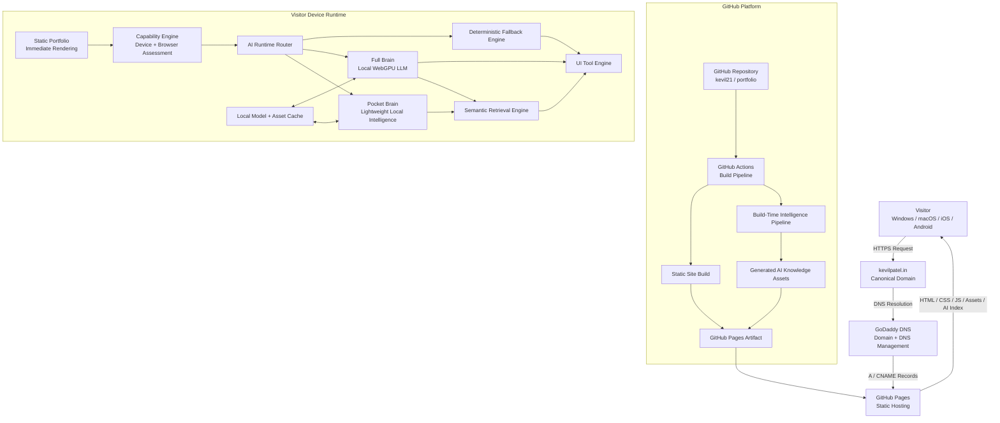

# Kevil Patel Portfolio — Local AI Architecture

## 1. Architecture Vision

`kevilpatel.in` is designed as a **laptop-first, mobile-safe, local-AI portfolio** where the website remains fully functional without AI, while capable devices progressively unlock richer AI experiences.

### Core principles

- **Static-first:** Core portfolio functionality never depends on an LLM.
- **Local AI:** Runtime AI inference executes on the visitor's device.
- **Progressive enhancement:** Stronger hardware unlocks stronger AI.
- **Mobile-safe:** Mobile devices never need to download or execute a large LLM.
- **Privacy-first:** Local AI interactions remain on the visitor's device.
- **Graceful degradation:** WebGPU, model, memory or AI failures never break the portfolio.
- **Evidence-grounded:** AI answers are grounded in structured portfolio content.
- **Zero mandatory backend:** No always-running application server, database or GPU is required.
- **Domain-first:** `kevilpatel.in` remains the canonical public entry point.
- **CI-generated intelligence:** Expensive/repetitive processing is moved from runtime to build time.

---

## 2. High-Level Architecture



---

# 3. Complete End-to-End Architecture

```mermaid
flowchart TB

%% =========================================================
%% AUTHORING LAYER
%% =========================================================

subgraph AUTHORING["1. Developer / Authoring Layer"]

    DEV["Developer Workstation<br/>macOS"]

    PERSONALSSH["Personal GitHub SSH Identity<br/>github-personal"]

    SOURCE["Source Repository"]

    CONTENT["Structured Portfolio Content<br/>Projects<br/>Experience<br/>Skills<br/>Certifications<br/>Education<br/>Achievements"]

    UI["Frontend Source<br/>Components<br/>Layouts<br/>Styles<br/>Interactions"]

    AICONFIG["AI Configuration<br/>Prompts<br/>Schemas<br/>Tool definitions<br/>Retrieval rules"]

    CONTEXT["project-context/<br/>Architecture Decisions<br/>Conventions<br/>Known Issues<br/>Design Context"]

    DEV --> PERSONALSSH
    PERSONALSSH --> SOURCE

    CONTENT --> SOURCE
    UI --> SOURCE
    AICONFIG --> SOURCE
    CONTEXT --> SOURCE
end


%% =========================================================
%% SOURCE CONTROL
%% =========================================================

subgraph SCM["2. Source Control Layer — GitHub"]

    MAIN["main<br/>Production Branch"]

    DEVBRANCH["dev<br/>Development Branch"]

    PR["Pull Request<br/>Review + Validation"]

    DEVBRANCH --> PR
    PR --> MAIN

end

SOURCE --> DEVBRANCH


%% =========================================================
%% CI BRAIN
%% =========================================================

subgraph BUILD["3. Build Brain — GitHub Actions"]

    TRIGGER["Push / Merge to main"]

    VALIDATE["Validation<br/>Lint<br/>Type Check<br/>Content Schema Validation"]

    SITEBUILD["Frontend Build<br/>Generate Static Website"]

    CONTENTPIPE["Portfolio Knowledge Pipeline"]

    CHUNK["Content Normalisation<br/>Chunk Portfolio Knowledge"]

    QA["Pre-generated Intelligence<br/>Common Portfolio Q&A<br/>Recruiter Answers<br/>Engineer Answers<br/>Architect Answers"]

    SKILLGRAPH["Skill / Project Relationship Graph"]

    EMBED["Generate Embeddings"]

    VECTOR["Compact Vector / Search Index"]

    METADATA["Evidence Metadata<br/>Source IDs<br/>Project References<br/>Skill References"]

    MANIFEST["AI Capability Manifest<br/>Model configuration<br/>Index version<br/>Feature flags"]

    PACKAGE["Production Artifact"]

    TRIGGER --> VALIDATE

    VALIDATE --> SITEBUILD
    VALIDATE --> CONTENTPIPE

    CONTENTPIPE --> CHUNK

    CHUNK --> QA
    CHUNK --> SKILLGRAPH
    CHUNK --> EMBED

    EMBED --> VECTOR

    QA --> METADATA
    SKILLGRAPH --> METADATA
    VECTOR --> METADATA

    METADATA --> MANIFEST

    SITEBUILD --> PACKAGE
    MANIFEST --> PACKAGE
end

MAIN --> TRIGGER


%% =========================================================
%% DEPLOYMENT
%% =========================================================

subgraph HOST["4. Hosting Layer"]

    PAGES["GitHub Pages<br/>Static Hosting"]

    CDN["Static Content Delivery"]

    TLS["GitHub Pages HTTPS<br/>TLS Certificate"]

    PAGES --> CDN
    TLS --> CDN
end

PACKAGE --> PAGES


%% =========================================================
%% DOMAIN
%% =========================================================

subgraph DOMAINLAYER["5. Domain + DNS Layer"]

    ROOT["kevilpatel.in"]

    WWW["www.kevilpatel.in"]

    GODADDY["GoDaddy DNS"]

    A1["A → 185.199.108.153"]
    A2["A → 185.199.109.153"]
    A3["A → 185.199.110.153"]
    A4["A → 185.199.111.153"]

    CNAME["CNAME<br/>www → kevil21.github.io"]

    VERIFY["GitHub Pages<br/>Domain Verification TXT"]

    ROOT --> GODADDY
    WWW --> GODADDY

    GODADDY --> A1
    GODADDY --> A2
    GODADDY --> A3
    GODADDY --> A4
    GODADDY --> CNAME
    GODADDY --> VERIFY

end

A1 --> CDN
A2 --> CDN
A3 --> CDN
A4 --> CDN
CNAME --> CDN


%% =========================================================
%% DEVICE ENTRY
%% ===================================