# Kevil Patel Portfolio — Local AI Architecture

## 1. Architecture Vision

`kevilpatel.in` is designed as a **laptop-first, mobile-safe, local-AI portfolio** where the website remains fully functional without AI, while capable devices progressively unlock richer AI experiences.

### Core principles

- **Static-first:** Core portfolio functionality never depends on an LLM.
- **Local AI:** Runtime AI inference executes on the visitor's device.
- **Progressive enhancement:** Stronger hardware unlocks stronger AI.
- **Mobile-safe:** Mobile devices never need to download or execute a large LLM.
- **Privacy-first:** Local AI interactions remain on the visitor's device.
- **Graceful degradation:** WebGPU, model, memory or AI failures never break the portfolio.
- **Evidence-grounded:** AI answers are grounded in structured portfolio content.
- **Zero mandatory backend:** No always-running application server, database or GPU is required.
- **Domain-first:** `kevilpatel.in` remains the canonical public entry point.
- **CI-generated intelligence:** Expensive/repetitive processing is moved from runtime to build time.

---

## 2. High-Level Architecture

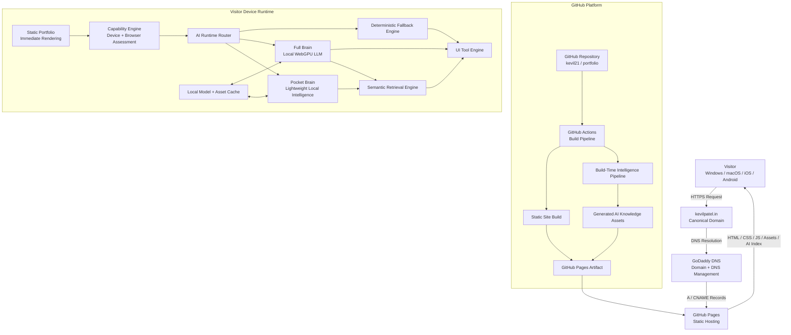

---

# 3. Complete End-to-End Architecture

```mermaid
flowchart TB

%% =========================================================
%% AUTHORING LAYER
%% =========================================================

subgraph AUTHORING["1. Developer / Authoring Layer"]

    DEV["Developer Workstation<br/>macOS"]

    PERSONALSSH["Personal GitHub SSH Identity<br/>github-personal"]

    SOURCE["Source Repository"]

    CONTENT["Structured Portfolio Content<br/>Projects<br/>Experience<br/>Skills<br/>Certifications<br/>Education<br/>Achievements"]

    UI["Frontend Source<br/>Components<br/>Layouts<br/>Styles<br/>Interactions"]

    AICONFIG["AI Configuration<br/>Prompts<br/>Schemas<br/>Tool definitions<br/>Retrieval rules"]

    CONTEXT["project-context/<br/>Architecture Decisions<br/>Conventions<br/>Known Issues<br/>Design Context"]

    DEV --> PERSONALSSH
    PERSONALSSH --> SOURCE

    CONTENT --> SOURCE
    UI --> SOURCE
    AICONFIG --> SOURCE
    CONTEXT --> SOURCE
end


%% =========================================================
%% SOURCE CONTROL
%% =========================================================

subgraph SCM["2. Source Control Layer — GitHub"]

    MAIN["main<br/>Production Branch"]

    DEVBRANCH["dev<br/>Development Branch"]

    PR["Pull Request<br/>Review + Validation"]

    DEVBRANCH --> PR
    PR --> MAIN

end

SOURCE --> DEVBRANCH


%% =========================================================
%% CI BRAIN
%% =========================================================

subgraph BUILD["3. Build Brain — GitHub Actions"]

    TRIGGER["Push / Merge to main"]

    VALIDATE["Validation<br/>Lint<br/>Type Check<br/>Content Schema Validation"]

    SITEBUILD["Frontend Build<br/>Generate Static Website"]

    CONTENTPIPE["Portfolio Knowledge Pipeline"]

    CHUNK["Content Normalisation<br/>Chunk Portfolio Knowledge"]

    QA["Pre-generated Intelligence<br/>Common Portfolio Q&A<br/>Recruiter Answers<br/>Engineer Answers<br/>Architect Answers"]

    SKILLGRAPH["Skill / Project Relationship Graph"]

    EMBED["Generate Embeddings"]

    VECTOR["Compact Vector / Search Index"]

    METADATA["Evidence Metadata<br/>Source IDs<br/>Project References<br/>Skill References"]

    MANIFEST["AI Capability Manifest<br/>Model configuration<br/>Index version<br/>Feature flags"]

    PACKAGE["Production Artifact"]

    TRIGGER --> VALIDATE

    VALIDATE --> SITEBUILD
    VALIDATE --> CONTENTPIPE

    CONTENTPIPE --> CHUNK

    CHUNK --> QA
    CHUNK --> SKILLGRAPH
    CHUNK --> EMBED

    EMBED --> VECTOR

    QA --> METADATA
    SKILLGRAPH --> METADATA
    VECTOR --> METADATA

    METADATA --> MANIFEST

    SITEBUILD --> PACKAGE
    MANIFEST --> PACKAGE
end

MAIN --> TRIGGER


%% =========================================================
%% DEPLOYMENT
%% =========================================================

subgraph HOST["4. Hosting Layer"]

    PAGES["GitHub Pages<br/>Static Hosting"]

    CDN["Static Content Delivery"]

    TLS["GitHub Pages HTTPS<br/>TLS Certificate"]

    PAGES --> CDN
    TLS --> CDN
end

PACKAGE --> PAGES


%% =========================================================
%% DOMAIN
%% =========================================================

subgraph DOMAINLAYER["5. Domain + DNS Layer"]

    ROOT["kevilpatel.in"]

    WWW["www.kevilpatel.in"]

    GODADDY["GoDaddy DNS"]

    A1["A → 185.199.108.153"]
    A2["A → 185.199.109.153"]
    A3["A → 185.199.110.153"]
    A4["A → 185.199.111.153"]

    CNAME["CNAME<br/>www → kevil21.github.io"]

    VERIFY["GitHub Pages<br/>Domain Verification TXT"]

    ROOT --> GODADDY
    WWW --> GODADDY

    GODADDY --> A1
    GODADDY --> A2
    GODADDY --> A3
    GODADDY --> A4
    GODADDY --> CNAME
    GODADDY --> VERIFY

end

A1 --> CDN
A2 --> CDN
A3 --> CDN
A4 --> CDN
CNAME --> CDN


%% =========================================================
%% DEVICE ENTRY
%% =========================================================

subgraph CLIENT["6. Client Runtime — Single Visitor Device"]

    REQUEST["https://kevilpatel.in"]

    SHELL["Static Application Shell"]

    CONTENTFIRST["Portfolio Content<br/>Available Without AI"]

    JS["Interactive Application Layer"]

    CAP["Capability Detection Engine"]

    DEVICECLASS["Device Capability Profile"]

    REQUEST --> SHELL

    SHELL --> CONTENTFIRST
    SHELL --> JS

    JS --> CAP
    CAP --> DEVICECLASS

end

CDN --> REQUEST


%% =========================================================
%% CAPABILITY ENGINE
%% =========================================================

subgraph CAPENGINE["7. Adaptive Capability Engine"]

    WEBGPU{"WebGPU<br/>Available?"}

    MEMORY{"Sufficient<br/>Resources?"}

    DATASAVER{"Data Saving /<br/>Restricted Device?"}

    REDUCED{"Reduced Motion<br/>Requested?"}

    TIER0["Tier 0<br/>Static Experience"]

    TIER1["Tier 1<br/>Pocket Brain"]

    TIER2["Tier 2<br/>Full Brain"]

    DEVICECLASS --> WEBGPU

    WEBGPU -->|"No"| TIER1
    WEBGPU -->|"Yes"| MEMORY

    MEMORY -->|"Low"| TIER1
    MEMORY -->|"Suitable"| DATASAVER

    DATASAVER -->|"Restricted"| TIER1
    DATASAVER -->|"Normal"| TIER2

    DEVICECLASS --> REDUCED

    REDUCED -->|"Yes"| TIER0

end


%% =========================================================
%% POCKET BRAIN
%% =========================================================

subgraph POCKETBRAIN["8. Pocket Brain — Universal Lightweight AI"]

    PW["Dedicated Web Worker"]

    EMBEDDER["Small Local Embedding Model"]

    SEMANTIC["Semantic Search"]

    LOCALINDEX["Pre-built Portfolio Index"]

    PREGEN["Pre-generated Answer Store"]

    RANKER["Evidence + Relevance Ranker"]

    RESULT["Grounded Portfolio Response"]

    PW --> EMBEDDER

    EMBEDDER --> SEMANTIC
    LOCALINDEX --> SEMANTIC

    SEMANTIC --> RANKER
    PREGEN --> RANKER

    RANKER --> RESULT

end

TIER1 --> PW


%% =========================================================
%% FULL BRAIN
%% =========================================================

subgraph FULLBRAIN["9. Full Brain — Laptop-Class Local AI"]

    OPTIN["Explicit Local AI Activation"]

    DOWNLOAD["Model Download"]

    MODELCACHE["Persistent Model Cache"]

    AIWORKER["Dedicated LLM Web Worker"]

    WEBLLM["Local WebGPU LLM"]

    RETRIEVE["Portfolio Retrieval"]

    PROMPT["Grounded Context Assembly"]

    GENERATE["Local Generation"]

    TOOLCALL["Structured Tool Calls"]

    OPTIN --> DOWNLOAD
    DOWNLOAD --> MODELCACHE

    MODELCACHE --> AIWORKER
    AIWORKER --> WEBLLM

    WEBLLM --> RETRIEVE
    RETRIEVE --> PROMPT
    PROMPT --> GENERATE

    GENERATE --> TOOLCALL

end

TIER2 --> OPTIN


%% =========================================================
%% KNOWLEDGE
%% =========================================================

subgraph KNOWLEDGE["10. Client Knowledge Layer"]

    KPROJECT["Projects"]

    KSKILLS["Skills"]

    KEXP["Experience"]

    KCERT["Certifications"]

    KRESUME["Résumé"]

    KEVIDENCE["Evidence References"]

    KANSWERS["Pre-generated Answers"]

    KINDEX["Vector / Semantic Index"]

end

PACKAGE -. "Published assets" .-> KPROJECT
PACKAGE -.-> KSKILLS
PACKAGE -.-> KEXP
PACKAGE -.-> KCERT
PACKAGE -.-> KRESUME
PACKAGE -.-> KEVIDENCE
PACKAGE -.-> KANSWERS
PACKAGE -.-> KINDEX

KINDEX --> LOCALINDEX
KANSWERS --> PREGEN

KPROJECT --> RETRIEVE
KSKILLS --> RETRIEVE
KEXP --> RETRIEVE
KCERT --> RETRIEVE
KRESUME --> RETRIEVE
KEVIDENCE --> RETRIEVE


%% =========================================================
%% AI ROUTER
%% =========================================================

subgraph ROUTING["11. AI Request Router"]

    INPUT["User Command / Question"]

    INTENT["Intent Detection"]

    ROUTE{"Select Execution Path"}

    STATICSEARCH["Standard Search"]

    POCKETPATH["Pocket Brain"]

    FULLPATH["Full Brain"]

    SAFE["Safe Deterministic Fallback"]

    INPUT --> INTENT
    INTENT --> ROUTE

    ROUTE --> STATICSEARCH
    ROUTE --> POCKETPATH
    ROUTE --> FULLPATH

    POCKETPATH -->|"runtime/model failure"| SAFE
    FULLPATH -->|"WebGPU/OOM/model failure"| POCKETPATH

end

POCKETPATH --> PW
FULLPATH --> AIWORKER


%% =========================================================
%% TOOL / ACTION LAYER
%% =========================================================

subgraph TOOLING["12. Agentic Portfolio Tool Layer"]

    TOOLROUTER["Tool Router"]

    NAV["navigateTo(section)"]

    FILTER["filterProjects(criteria)"]

    PROJECT["openProject(id)"]

    SKILL["highlightSkill(skill)"]

    RESUME["openResume()"]

    PERSONA["switchPersona(mode)"]

    MATCH["showRelevantExperience(criteria)"]

    TOOLROUTER --> NAV
    TOOLROUTER --> FILTER
    TOOLROUTER --> PROJECT
    TOOLROUTER --> SKILL
    TOOLROUTER --> RESUME
    TOOLROUTER --> PERSONA
    TOOLROUTER --> MATCH

end

TOOLCALL --> TOOLROUTER
RESULT --> TOOLROUTER
SAFE --> TOOLROUTER


%% =========================================================
%% EXPERIENCE
%% =========================================================

subgraph EXPERIENCE["13. Adaptive Experience Layer"]

    DESKTOP["Desktop Experience"]

    MOBILE["Mobile Experience"]

    COMMAND["Unified Command Interface"]

    CARDS["Evidence-backed Answer Cards"]

    PROJECTUI["Project Explorer"]

    TIMELINE["Experience Timeline"]

    SKILLUI["Interactive Skill Map"]

    JD["Local Role / JD Matcher"]

    EXPLAIN["Explain Project<br/>Recruiter / Engineer / Architect"]

    OBSERVE["Local AI Observatory<br/>Model tier<br/>Execution mode<br/>Retrieved sources"]

    COMMAND --> CARDS
    CARDS --> PROJECTUI
    CARDS --> TIMELINE
    CARDS --> SKILLUI
    CARDS --> JD
    CARDS --> EXPLAIN

    DESKTOP --> COMMAND
    MOBILE --> COMMAND

    OBSERVE --> COMMAND

end

TOOLROUTER --> EXPERIENCE


%% =========================================================
%% CACHE / PWA
%% =========================================================

subgraph OFFLINE["14. Local Storage + Offline Layer"]

    SW["Service Worker"]

    STATICCACHE["Static Asset Cache"]

    AICACHE["AI Model Cache"]

    INDEXCACHE["Knowledge Index Cache"]

    UPDATE["Version / Update Detection"]

    SW --> STATICCACHE
    SW --> AICACHE
    SW --> INDEXCACHE
    SW --> UPDATE

end

MODELCACHE --> AICACHE
LOCALINDEX --> INDEXCACHE
SHELL --> SW


%% =========================================================
%% SAFETY & RESILIENCE
%% =========================================================

subgraph RESILIENCE["15. Resilience Layer"]

    NOJS["JavaScript unavailable<br/>Static portfolio remains usable"]

    NOMODEL["Model unavailable<br/>Use Pocket Brain / Search"]

    NOWEBGPU["WebGPU unavailable<br/>Use Pocket Brain"]

    OOM["Memory pressure / crash<br/>Unload Full Brain"]

    OFFLINESTATE["Offline<br/>Use cached compatible functionality"]

    NOHALL["Insufficient evidence<br/>Return source content instead of inventing"]

end

TIER0 --> NOJS
TIER1 --> NOWEBGPU
FULLBRAIN -.-> OOM
OOM --> POCKETBRAIN
SAFE --> NOHALL
SW --> OFFLINESTATE
```

---

# 4. Runtime Intelligence Model

The runtime is intentionally **not binary AI/no-AI**.

The architecture exposes three capability tiers.

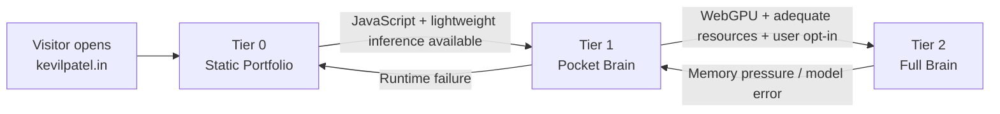

### Tier 0 — Static

Provides the complete core portfolio:

- Projects
- Skills
- Experience
- Certifications
- Résumé
- Contact details
- Navigation
- Standard filtering/search

AI availability is **never required** to understand the portfolio.

### Tier 1 — Pocket Brain

Designed to work across the broadest range of devices.

Responsibilities:

- semantic portfolio search
- query-to-project matching
- pre-generated answer retrieval
- evidence ranking
- lightweight role/JD matching
- recommendation of relevant portfolio sections

No large generative model is required.

### Tier 2 — Full Brain

Designed primarily for capable laptops/desktops.

Adds:

- local generative AI
- grounded portfolio Q&A
- deeper JD analysis
- natural-language navigation
- tool calling
- project explanations
- persona-specific answers
- multi-step portfolio exploration

Tier 2 enhances Tier 1 rather than replacing Tier 1.

---

# 5. AI Request Lifecycle

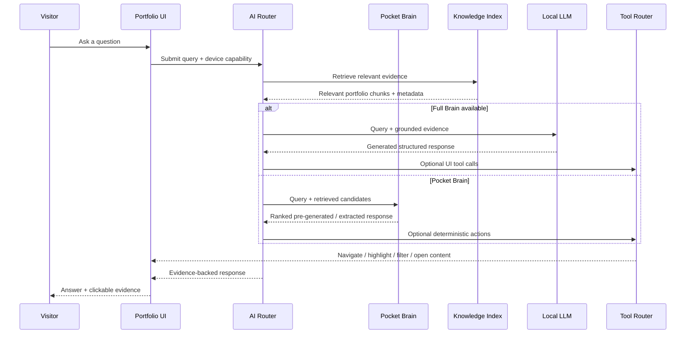

---

# 6. Example: Recruiter Interaction

A recruiter enters:

> Show me Kevil's strongest cloud and AI projects.

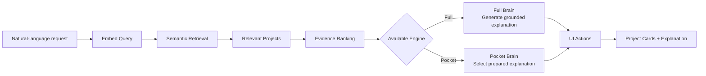

The AI is therefore not merely producing text.

The same request can:

1. determine intent;
2. retrieve evidence;
3. rank projects;
4. explain why they match;
5. filter the project view;
6. highlight related skills;
7. provide links to underlying project evidence.

---

# 7. Job Description Matcher

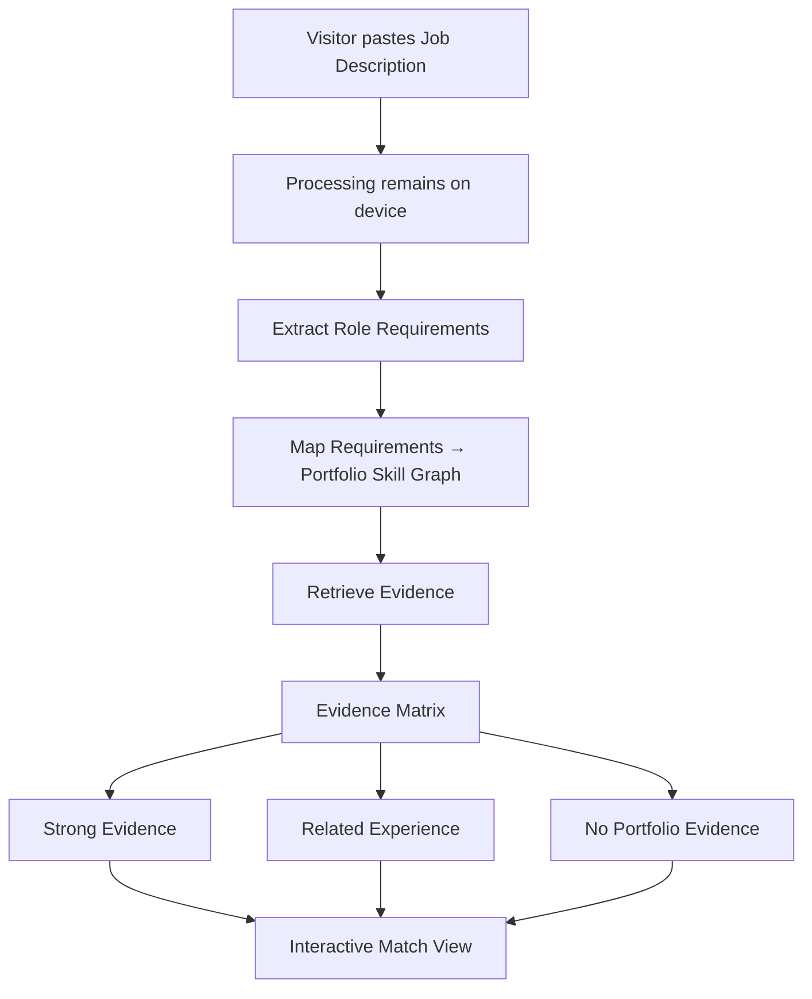

An important architectural rule is:

> **No evidence = no claim.**

The matcher should distinguish between:

- explicitly demonstrated skill,
- related experience,
- and unsupported requirement.

That makes the feature more credible in interviews than an arbitrary percentage match.

---

# 8. Agentic UI

The local LLM does not receive unrestricted access to JavaScript.

Instead, it emits a constrained set of structured actions:

```text
navigateTo(section)
filterProjects(criteria)
openProject(projectId)
highlightSkill(skillId)
openResume()
switchPersona(persona)
showRelevantExperience(criteria)
```

Architecture:

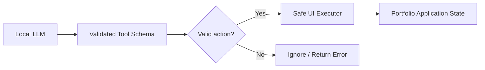

The model therefore suggests actions but does not directly manipulate arbitrary page state.

---

# 9. Persona Architecture

The portfolio supports different information depth without maintaining three different websites.

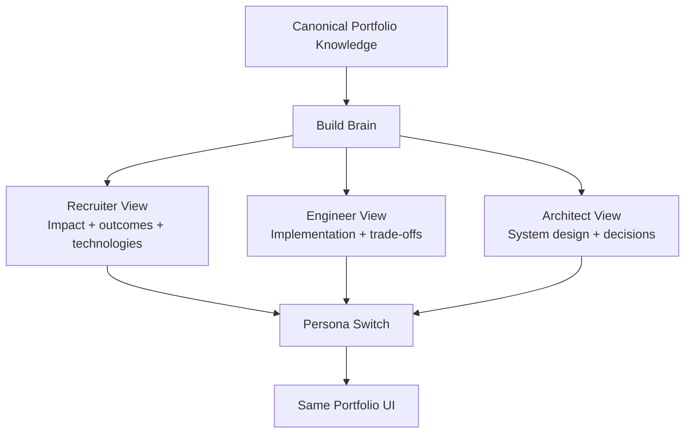

The canonical portfolio content remains the source of truth.

Persona variants change **presentation depth**, not underlying facts.

---

# 10. Desktop and Mobile Experience

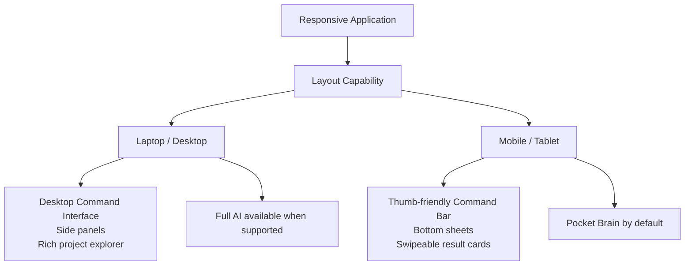

Mobile is **not a reduced site**.

Mobile retains:

- complete portfolio content
- semantic search
- project exploration
- résumé access
- role/JD matching where supported
- AI-assisted discovery

What changes is computational intensity and presentation, not access to information.

---

# 11. Model Failure Strategy

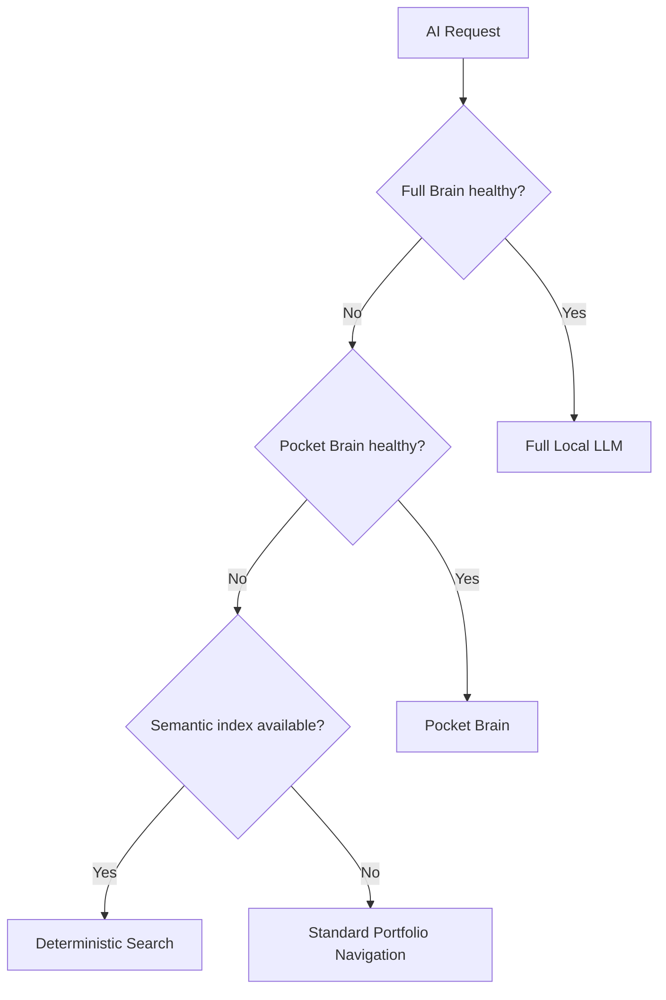

Thus:

```text
Full Brain
    ↓ failure

Pocket Brain
    ↓ failure

Semantic Search
    ↓ failure

Static Portfolio
```

**There is no architecture path that ends in "Website unavailable because AI failed".**

---

# 12. Deployment Lifecycle

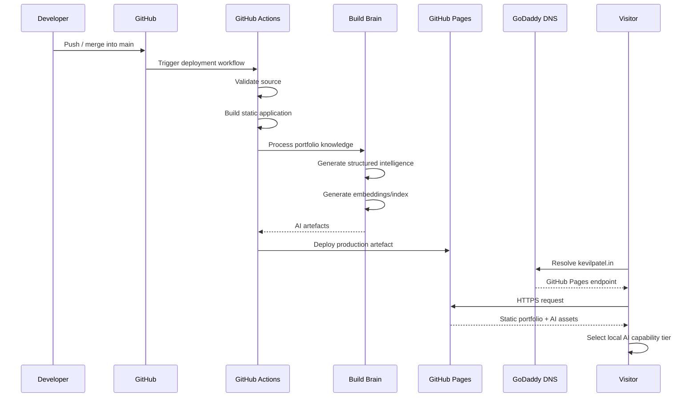

---

# 13. DNS Architecture

The domain layer remains independent from application deployment.

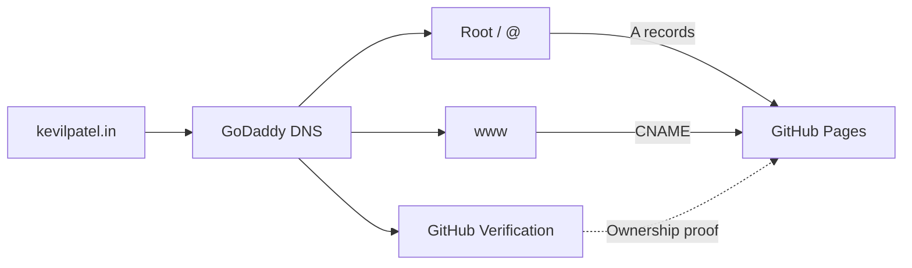

Changing application code therefore does not require changing domain configuration.

---

# 14. Privacy Boundary

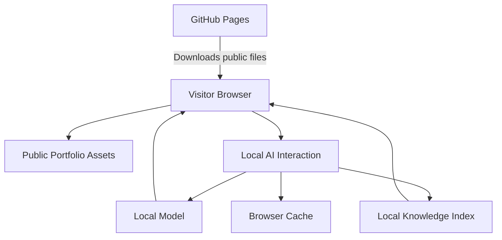

The architectural goal is:

> **The hosting layer distributes the intelligence; the visitor's device executes the intelligence.**

---

# 15. Repository Architecture

```text
kevilpatel/
│
├── .github/
│   └── workflows/
│       ├── validate.yml
│       └── deploy.yml
│
├── content/
│   ├── profile/
│   ├── projects/
│   ├── experience/
│   ├── skills/
│   ├── certifications/
│   └── education/
│
├── src/
│   ├── components/
│   ├── layouts/
│   ├── pages/
│   ├── styles/
│   │
│   ├── ai/
│   │   ├── runtime/
│   │   │   ├── capability.ts
│   │   │   ├── router.ts
│   │   │   └── fallback.ts
│   │   │
│   │   ├── pocket/
│   │   │   ├── embedder.ts
│   │   │   ├── retrieval.ts
│   │   │   └── ranking.ts
│   │   │
│   │   ├── full/
│   │   │   ├── model.ts
│   │   │   ├── inference.ts
│   │   │   └── prompting.ts
│   │   │
│   │   ├── tools/
│   │   │   ├── navigation.ts
│   │   │   ├── projects.ts
│   │   │   ├── resume.ts
│   │   │   └── skills.ts
│   │   │
│   │   └── workers/
│   │       ├── pocket.worker.ts
│   │       └── llm.worker.ts
│   │
│   └── features/
│       ├── semantic-search/
│       ├── ai-assistant/
│       ├── jd-matcher/
│       ├── persona-switcher/
│       └── architecture-observatory/
│
├── scripts/
│   ├── build-knowledge.ts
│   ├── build-index.ts
│   ├── validate-content.ts
│   └── generate-personas.ts
│
├── public/
│   ├── assets/
│   ├── models/
│   └── generated/
│       ├── knowledge-index.json
│       ├── answer-index.json
│       ├── skill-graph.json
│       └── ai-manifest.json
│
├── project-context/
│   ├── architecture.md
│   ├── decisions/
│   │   ├── ADR-001-local-first-ai.md
│   │   ├── ADR-002-progressive-ai.md
│   │   ├── ADR-003-static-hosting.md
│   │   └── ADR-004-evidence-grounding.md
│   ├── conventions.md
│   ├── known-issues.md
│   └── roadmap.md
│
├── CLAUDE.md
├── README.md
└── package.json
```

---

# 16. Key Architecture Decisions

## ADR-001 — Static-first architecture

The portfolio must remain completely useful when:

- JavaScript fails;
- WebGPU is unavailable;
- the AI model cannot load;
- the device has insufficient memory;
- the visitor disables artificial intelligence.

---

## ADR-002 — Browser-side inference

Generative inference executes locally when supported.

Benefits:

- no mandatory inference API;
- no always-running GPU server;
- visitor-controlled processing;
- no per-query inference bill;
- architecture itself becomes demonstrable.

---

## ADR-003 — Build-time intelligence

Tasks that do not need to happen per visitor should happen during CI.

Examples:

- content normalisation;
- search-index creation;
- pre-generated Q&A;
- skill relationship generation;
- persona variants;
- evidence metadata.

Runtime computation is reserved for genuinely interactive tasks.

---

## ADR-004 — Mobile does not run mandatory Full Brain

Full Brain is an enhancement.

Mobile and constrained environments use Pocket Brain as the primary intelligent layer.

Therefore:

```text
Desktop ≠ full website
Mobile  ≠ reduced website

Desktop = full website + stronger local compute
Mobile  = full website + lighter local compute
```

---

## ADR-005 — AI is not allowed to become the source of truth

Canonical facts come from structured portfolio content.

```text
Portfolio Content
      ↓
Evidence Index
      ↓
Retrieval
      ↓
AI
      ↓
Presentation
```

Never:

```text
LLM Memory
      ↓
Assume facts about Kevil
```

---

# 17. Architecture Differentiator

The portfolio is not:

> "A website with a chatbot."

The architecture is:

> **A static application that ships an adaptive intelligence layer to the visitor's device.**

The website decides how much intelligence can execute safely on the current hardware:

```text
STATIC WEB
     ↓
SEMANTIC WEB
     ↓
LOCAL AI WEB
     ↓
AGENTIC UI
```

while maintaining the same canonical content, domain, privacy boundary and user experience.

---

# 18. Interview Architecture Summary

> **kevilpatel.in is a static-first, local-AI portfolio deployed through GitHub Pages. GitHub Actions acts as the Build Brain, transforming canonical portfolio content into static pages, evidence metadata and semantic indexes before deployment. At runtime, a capability engine selects between a lightweight Pocket Brain and an optional WebGPU Full Brain. AI executes locally inside Web Workers and interacts with the portfolio through a constrained tool layer rather than directly manipulating the application. If AI, WebGPU or JavaScript fails, the architecture progressively falls back until it reaches the fully usable static portfolio. The result has no mandatory inference backend and treats AI as progressive enhancement rather than infrastructure dependency.**